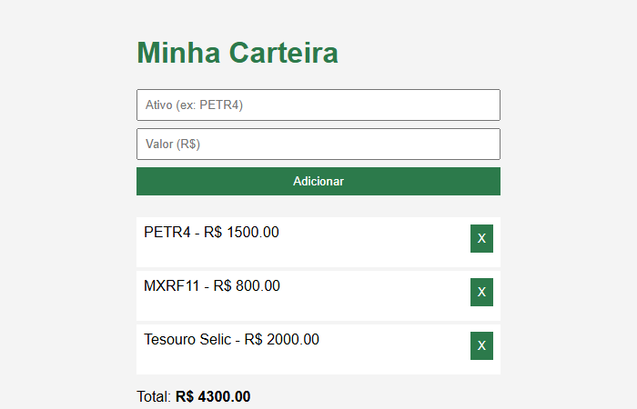
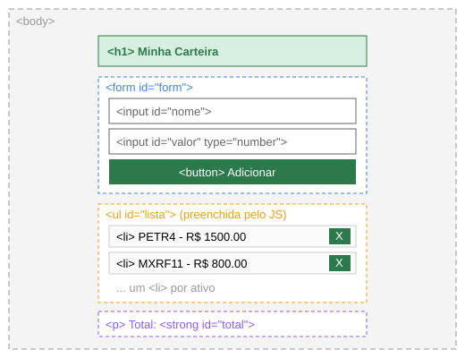

# Versão 1 — Lista simples

> **Objetivo:** entender o papel de cada arquivo. **HTML** é a estrutura, **CSS** é a aparência e **JS** é o comportamento.

## Onde queremos chegar



Esquema da página (quais tags formam cada parte):



**O que a página faz:** você digita um ativo (ex: PETR4) e um valor e clica em **Adicionar**. O ativo aparece na lista e o total é somado. O **X** remove um item.

**Como abrir:** dê dois cliques no `index.html`. Não precisa instalar nada.

---

## O que tem de novo

### HTML (`index.html`)

| Tag | Pra que serve |
|-----|---------------|
| `<!DOCTYPE html>` | Avisa ao navegador que o arquivo é HTML moderno |
| `<html lang="pt-BR">` | Raiz da página. O `lang` diz o idioma |
| `<head>` | Informações *sobre* a página, que não aparecem no corpo |
| `<meta charset="UTF-8">` | Faz acentos (ç, ã) aparecerem certo |
| `<title>` | Texto da aba do navegador |
| `<link rel="stylesheet" href="...">` | Liga o arquivo CSS |
| `<body>` | Tudo que aparece na tela |
| `<h1>` | Título principal (existe de `h1` até `h6`) |
| `<form>` | Agrupa campos que são enviados juntos |
| `<input>` | Campo de digitação. `type="number"` aceita só números, `required` torna o campo obrigatório |
| `<button type="submit">` | Botão que envia o formulário |
| `<ul>` / `<li>` | Lista não ordenada / item da lista |
| `<p>` / `<strong>` | Parágrafo / texto em destaque (negrito) |
| `<script src="...">` | Liga o arquivo JS. Fica no fim do `body` pra rodar depois que os elementos já existem |

**Atributo `id`:** é um nome único que damos a um elemento (`id="lista"`). O JavaScript usa esse nome pra encontrar o elemento.

### CSS (`style.css`)

Uma regra CSS tem esta forma:
```css
seletor {
  propriedade: valor;
}
```

| Conceito | Exemplo | O que faz |
|----------|---------|-----------|
| Seletor de tag | `body`, `button`, `li` | Aplica a regra em **todas** as tags daquele tipo |
| Vários seletores | `input, button` | Aplica a mesma regra nos dois |
| `color` / `background` | `color: white` | Cor do texto / cor do fundo |
| `padding` | `padding: 8px` | Espaço **dentro** do elemento |
| `margin` | `margin-bottom: 8px` | Espaço **fora** do elemento |
| `margin: 40px auto` | — | `auto` nas laterais centraliza o bloco |
| `max-width` | `max-width: 400px` | Largura máxima |
| `width: 100%` | — | Ocupa toda a largura disponível |
| `box-sizing: border-box` | — | Faz o padding contar dentro da largura (evita o elemento "estourar") |
| `display: flex` | no `li` | Coloca os filhos lado a lado (veremos a fundo na v2) |
| `justify-content: space-between` | no `li` | Empurra os filhos para as pontas |

### JavaScript (`script.js`)

| Comando | O que faz |
|---------|-----------|
| `const` | Cria uma variável que não vai ser reatribuída |
| `let` | Cria uma variável que pode mudar (`let soma = 0`) |
| `document.getElementById("x")` | Busca no HTML o elemento com `id="x"` |
| `[]` | Cria um array (uma lista) |
| `{ nome: "PETR4", valor: 10 }` | Cria um objeto (um conjunto de chave e valor) |
| `array.push(item)` | Adiciona um item no fim do array |
| `array.splice(indice, 1)` | Remove 1 item na posição `indice` |
| `array.forEach(function (item, indice) {...})` | Percorre cada item do array |
| `elemento.addEventListener("submit", fn)` | Executa `fn` quando o evento acontece |
| `evento.preventDefault()` | Impede o comportamento padrão (o form recarregaria a página) |
| `input.value` | O texto digitado no campo (sempre vem como texto!) |
| `Number("10")` | Converte texto em número |
| `form.reset()` | Limpa os campos do formulário |
| `document.createElement("li")` | Cria um elemento novo (ainda fora da tela) |
| `elemento.textContent = "..."` | Define o texto do elemento |
| `pai.appendChild(filho)` | Coloca o elemento dentro de outro, e aí ele aparece na tela |
| `lista.innerHTML = ""` | Apaga tudo que tem dentro do elemento |
| `numero.toFixed(2)` | Formata com 2 casas decimais |
| `function desenhar() {...}` | Declara uma função |

**A ideia central:** os dados ficam no array `ativos`. Sempre que eles mudam, chamamos `desenhar()`, que apaga a lista e redesenha tudo a partir do array.

---

## Comparando com Java

| Java | JavaScript |
|------|-----------|
| `String nome = "PETR4";` | `const nome = "PETR4";` (sem declarar o tipo) |
| `List<Ativo> ativos = new ArrayList<>();` | `const ativos = [];` |
| `new Ativo("PETR4", 10)` | `{ nome: "PETR4", valor: 10 }` (objeto sem precisar de classe) |
| `for (Ativo a : ativos) {...}` | `ativos.forEach(function (a) {...})` |
| `System.out.println(x)` | `console.log(x)` (aperte **F12 → Console**) |

## Roteiro do professor (~1h)
1. **0–15 min (HTML):** abrir a página sem o `<link>` do CSS e mostrar como ela fica "crua". Explicar `id`.
2. **15–25 min (CSS):** religar o CSS, mudar uma cor ao vivo e dar F5.
3. **25–50 min (JS):** seguir os 4 blocos numerados do `script.js`, na ordem.
4. **50–60 min:** fazer a comparação com Java e usar `console.log(ativos)` no Console (F12).

## Exercícios
1. Não deixar adicionar valor negativo (dica: `if (valor < 0) return;`).
2. Mostrar o total em vermelho quando for zero.
3. Adicionar um campo "quantidade" e mostrar `valor x quantidade`.

> **Gancho pra próxima versão:** a página funciona, mas o visual é bem simples. Na v2 a gente organiza o layout com **Flexbox** e **Grid**.
