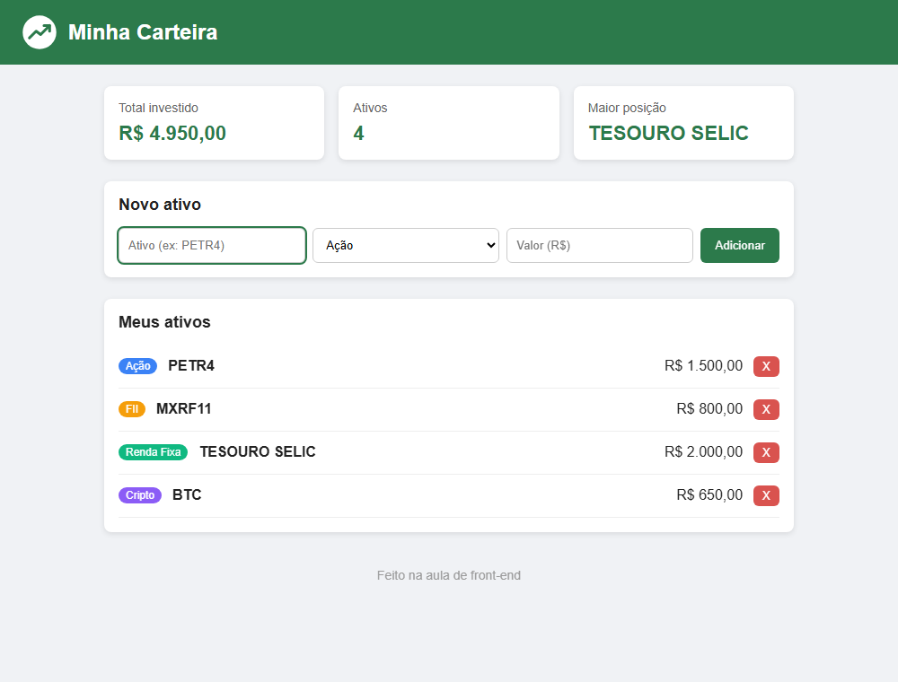
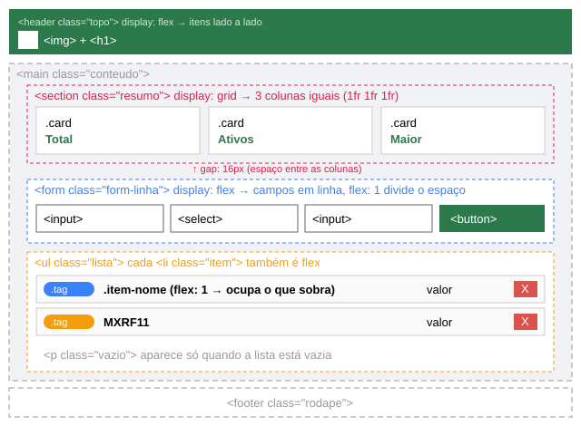

# Versão 2 — Layout com Flexbox e Grid

> **Objetivo:** organizar a página em partes com significado (cabeçalho, conteúdo, rodapé), estilizar usando **classes** e posicionar os elementos com **Flexbox** e **Grid**.

## Onde queremos chegar



Esquema do layout. Mostra onde usamos Flexbox e onde usamos Grid:



**O que mudou em relação à v1:**
- Cabeçalho verde com logo
- 3 cards de resumo: total, quantidade de ativos e maior posição
- Formulário em uma linha só, com um campo novo de **tipo** (Ação, FII, Renda Fixa, Cripto)
- Cada ativo tem uma etiqueta colorida conforme o tipo
- Valores formatados como dinheiro brasileiro: `R$ 1.500,00`
- Mensagem "Nenhum ativo ainda" quando a lista está vazia

---

## O que tem de novo

### HTML (`index.html`)

| Tag / atributo | Pra que serve |
|----------------|---------------|
| `<meta name="viewport" ...>` | Faz a página se ajustar à tela do celular (vamos usar muito na v4) |
| `<header>` | Cabeçalho da página |
| `<main>` | Conteúdo principal (só existe **um** por página) |
| `<section>` | Uma seção/bloco do conteúdo |
| `<footer>` | Rodapé |
| `<h2>` | Subtítulo (um nível abaixo do `h1`) |
| `<div>` | Caixa genérica, sem significado. Usamos quando nenhuma tag semântica serve |
| `<span>` | Igual ao `div`, mas fica **na linha**, sem quebrar |
| `` | Imagem. O `alt` descreve a imagem pra quem não consegue ver (leitores de tela) |
| `<select>` / `<option>` | Caixa de seleção. O `value` é o que o JS lê e o texto é o que aparece pro usuário |
| `class="..."` | Nome usado pelo CSS. Diferente do `id`, **vários elementos podem ter a mesma classe**, e um elemento pode ter várias (`class="tag tag-fii"`) |
| `min="0"` no input | Não aceita número negativo |

> **Por que `header`/`main`/`footer` e não só `div`?** Visualmente dá no mesmo. Mas essas tags dizem **o que** cada parte é. Isso ajuda leitores de tela, o Google e quem for ler o código depois. Isso se chama **HTML semântico**.

### CSS (`style.css`)

**Seletores novos:**

| Seletor | Exemplo | Seleciona |
|---------|---------|-----------|
| Universal | `*` | Todos os elementos |
| Classe | `.card` | Todo elemento com `class="card"` |
| Descendente | `.topo h1` | Todo `h1` que esteja **dentro** de `.topo` |
| Pseudo-classe `:hover` | `button:hover` | O botão **enquanto o mouse está em cima** |
| Pseudo-classe `:focus` | `input:focus` | O campo **enquanto o usuário digita nele** |

**Propriedades novas:**

| Propriedade | O que faz |
|-------------|-----------|
| `border` | Borda: `1px solid #ccc` é a espessura, o estilo e a cor |
| `border-radius` | Arredonda os cantos |
| `box-shadow` | Sombra: `0 2px 6px rgba(0,0,0,0.1)` é x, y, desfoque e cor |
| `rgba(0, 0, 0, 0.1)` | Cor com transparência (o último número vai de 0 a 1) |
| `font-size` / `font-weight` | Tamanho / peso (negrito) da fonte |
| `text-align: center` | Centraliza o texto |
| `cursor: pointer` | Mostra a "mãozinha" ao passar o mouse |
| `outline` | Contorno que aparece quando o campo está em foco |
| `display: none` | Esconde o elemento (usado na classe `.escondido`) |

#### Flexbox: organizar em **uma direção** (linha ou coluna)

Você coloca `display: flex` no **pai**, e os **filhos** se organizam:

```css
.topo {
  display: flex;        /* filhos lado a lado */
  align-items: center;  /* centraliza na vertical */
  gap: 12px;            /* espaço entre os filhos */
}
```

| Propriedade (no pai) | O que faz |
|----------------------|-----------|
| `display: flex` | Ativa o flexbox. Os filhos ficam em linha |
| `flex-direction: column` | Muda para coluna, um embaixo do outro (veja o `.card`) |
| `gap` | Espaço entre os filhos |
| `align-items: center` | Alinha os filhos no eixo **cruzado** (na linha, isso é a vertical) |
| `justify-content` | Alinha os filhos no eixo **principal**: `space-between`, `center`, `flex-end`... |

| Propriedade (no filho) | O que faz |
|------------------------|-----------|
| `flex: 1` | "Cresça e ocupe o espaço que sobrar". No form, cada campo com `flex: 1` divide o espaço igualmente. No `.item-nome`, empurra o valor e o X pra direita |

#### Grid: organizar em **linhas e colunas** ao mesmo tempo

```css
.resumo {
  display: grid;
  grid-template-columns: repeat(3, 1fr); /* 3 colunas de tamanho igual */
  gap: 16px;
}
```

| Propriedade | O que faz |
|-------------|-----------|
| `display: grid` | Ativa o grid no pai |
| `grid-template-columns` | Define as colunas. `200px 1fr` cria uma coluna fixa e outra flexível |
| `1fr` | "1 fração" do espaço livre. `1fr 2fr` faz a segunda coluna ter o dobro da primeira |
| `repeat(3, 1fr)` | Atalho para `1fr 1fr 1fr` |

> **Quando usar qual?** Para coisas numa **linha só** (menu, formulário, item de lista), use **Flex**. Para uma **grade** (cards, galeria, layout da página), use **Grid**.

**Teste no navegador:** aperte F12, clique num elemento com `display: flex` ou `grid` e veja o selo **flex**/**grid** no painel. Clicando nele, o navegador desenha as linhas na tela.

### JavaScript (`script.js`)

| Comando | O que faz |
|---------|-----------|
| `document.querySelector("#form")` | Busca usando **seletor de CSS** (`#` para id, `.` para classe). Faz tudo que o `getElementById` faz e mais um pouco |
| `elemento.querySelector(".btn-remover")` | Busca só **dentro** daquele elemento |
| `` `Olá ${nome}` `` | **Template literal**: texto entre crases que aceita variáveis dentro de `${ }` e pode ter várias linhas |
| `elemento.innerHTML = "<span>...</span>"` | Coloca **HTML** dentro do elemento (o `textContent` coloca só texto) |
| `elemento.classList.add("item")` | Adiciona uma classe |
| `elemento.classList.toggle("escondido", condicao)` | Adiciona a classe se a condição for `true` e remove se for `false` |
| `numero.toLocaleString("pt-BR", { style: "currency", currency: "BRL" })` | Formata como dinheiro: `R$ 1.500,00` |
| `texto.trim()` | Remove os espaços do começo e do fim |
| `texto.toUpperCase()` | Deixa tudo maiúsculo |
| `input.focus()` | Coloca o cursor no campo |
| `array.length` | Quantidade de itens |
| `array.reduce(fn, 0)` | "Reduz" o array a um valor só. Aqui, soma todos os valores começando do 0 |
| `for (const ativo of ativos)` | Outro jeito de percorrer o array, igual ao for-each do Java |
| `===` | Comparação **estrita** (tipo e valor). Em JS, use sempre `===` em vez de `==` |
| `return` sozinho | Sai da função mais cedo |
| `NOMES_TIPO[ativo.tipo]` | Usa o objeto como **dicionário**: busca o valor pela chave |
| `function formatarMoeda(n) { return ... }` | Função que **retorna** um valor, pra ser reaproveitada em vários lugares |

**Organização nova:** o `desenhar()` agora cuida só da lista e chama o `desenharResumo()`, que cuida dos cards. Cada função tem uma responsabilidade.

> ⚠️ **Cuidado com `innerHTML`:** ele interpreta o texto como HTML. Se o usuário digitar `<b>oi</b>` no nome do ativo, aparece "oi" em negrito. Aqui o usuário só mexe nos próprios dados, então não tem problema. Mas num site real com dados de outras pessoas isso é uma falha de segurança (chamada **XSS**). Para texto vindo do usuário, prefira `textContent`.

---

## Comparando com Java

| Java | JavaScript |
|------|-----------|
| `String.format("Olá %s", nome)` | `` `Olá ${nome}` `` |
| `Map<String,String> m = Map.of("fii","FII");` + `m.get("fii")` | `const m = { fii: "FII" };` + `m["fii"]` |
| `lista.size()` | `lista.length` |
| `lista.stream().mapToDouble(a -> a.getValor()).sum()` | `lista.reduce((soma, a) => soma + a.valor, 0)` |
| `for (Ativo a : ativos)` | `for (const a of ativos)` |
| `a.equals(b)` / `==` | `===` |

## Roteiro do professor (~1h)
1. **0–10 min (HTML semântico):** trocar as tags e mostrar que a página continua igual. Explicar o porquê das tags semânticas e a diferença entre `class` e `id`.
2. **10–35 min (Flexbox e Grid):** montar o `.topo` com flex, depois o `.form-linha` e por último o `.resumo` com grid. Brincar ao vivo: trocar `repeat(3, 1fr)` por `1fr 2fr 1fr`, tirar o `flex: 1`, trocar o `align-items`. Mostrar o selo flex/grid no F12.
3. **35–55 min (JS):** `querySelector`, template literal, `toLocaleString`, `classList.toggle` e por fim o `reduce`, comparando com o stream do Java.
4. **55–60 min:** comentar o aviso sobre `innerHTML` e propor os exercícios.

## Exercícios
1. Adicione um 4º card "Menor posição" (dica: mude o grid para `repeat(4, 1fr)`).
2. Crie um novo tipo "Exterior" com uma cor própria de etiqueta.
3. Faça o card do total ocupar 2 colunas (pesquise `grid-column: span 2`).
4. Mostre a porcentagem de cada ativo em relação ao total, ao lado do valor.

> **Gancho pra próxima versão:** recarregue a página e veja que os ativos **somem**. Na v3 vamos guardar os dados no navegador (`localStorage`) e mostrar tudo numa **tabela**.
