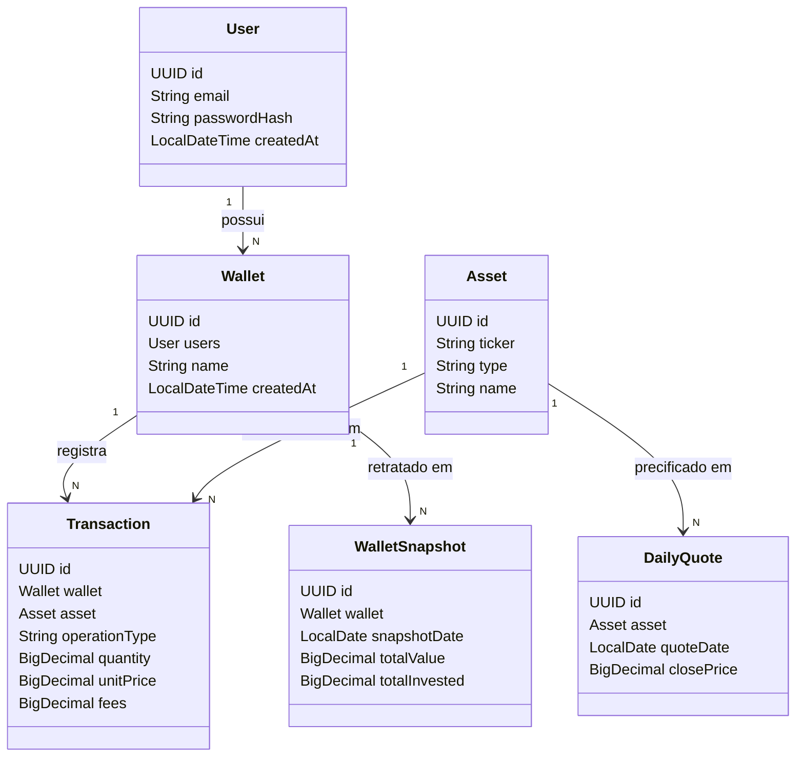
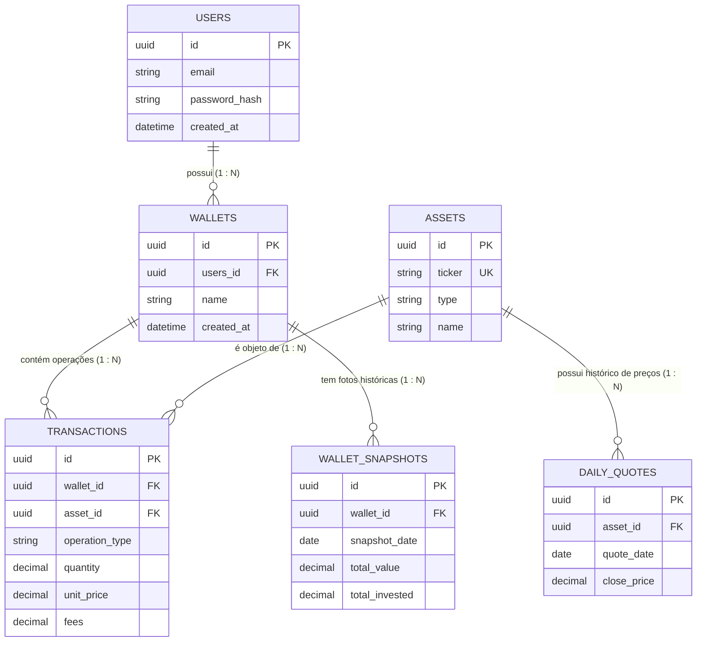
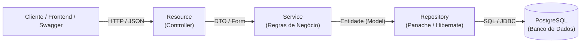

# 📊 Invest-Tracker: Análise da Aplicação e Guia das Entidades

---

## 💡 1. O que é esta aplicação? (Visão Geral e Objetivo)

O **Invest-Tracker** é uma aplicação de retaguarda (*backend*) desenvolvida em **Java 21** e **Quarkus 3**, projetada para resolver um dos desafios mais comuns de qualquer investidor: **controlar, centralizar e monitorar a evolução do seu patrimônio financeiro ao longo do tempo**.

### O Problema que Ela Resolve
Quando uma pessoa começa a investir, ela adquire diferentes tipos de ativos (ações de empresas, cotas de fundos imobiliários, títulos de renda fixa, moedas digitais) e frequentemente utiliza mais de uma corretora ou conta bancária. Manter o controle de quantas cotas possui, qual foi o preço médio pago em cada compra, quanto foi pago de taxas e quanto o patrimônio está valendo hoje em relação ao que foi desembolsado é uma tarefa propensa a erros caso feita manualmente em planilhas dispersas.

### O Objetivo do Sistema
O objetivo do **Invest-Tracker** é fornecer uma API REST robusta e segura para:
1. **Cadastrar investidores (usuários)** com segurança.
2. **Organizar investimentos em carteiras temáticas** (ex.: *Aposentadoria*, *Reserva de Emergência*, *Ações Brasileiras*).
3. **Manter um catálogo unificado de ativos do mercado financeiro** (ex.: PETR4, VALE3, HGLG11, Tesouro Selic).
4. **Registrar cada transação de compra e venda** com precisão de centavos e frações de cotas.
5. **Armazenar cotações diárias do mercado**, permitindo saber o valor de mercado atualizado de cada ativo.
6. **Tirar "fotos" (snapshots) patrimoniais da carteira**, comparando o **total investido** com o **valor de mercado atual**, viabilizando gráficos de rentabilidade e desempenho histórico.

---

## 🧱 2. Dicionário e Detalhamento das Entidades (Inglês $\to$ Português)

O código-fonte da aplicação foi construído em inglês, que é o padrão da indústria de software. Abaixo, cada uma das **6 entidades** do domínio é explicada em português, detalhando o que é, para que serve e quais campos ela possui.



---

### 2.1. `User` $\to$ **Usuário / Investidor**

* **Arquivo:** `model/User.java`
* **O que é no mundo real?** É a pessoa física cadastrada no sistema. O dono dos investimentos.
* **Para que serve?** Serve para identificar quem está acessando o sistema e garantir que cada investidor veja e modifique apenas os seus próprios dados.

#### Campos da Entidade:
| Campo no Código | Tipo | Nome em Português | O que armazena? |
| :--- | :--- | :--- | :--- |
| `id` | `UUID` | Identificador Único | Código único universal gerado para identificar o usuário. |
| `email` | `String` | E-mail | Endereço de correio eletrônico único, usado para login e contato. |
| `passwordHash` | `String` | Senha Criptografada | Hash de segurança da senha (nunca salvamos a senha pura em texto). |
| `createdAt` | `LocalDateTime` | Data de Cadastro | Momento exato em que a conta foi criada. |

---

### 2.2. `Wallet` $\to$ **Carteira de Investimentos / Portfólio**

* **Arquivo:** `model/Wallet.java`
* **O que é no mundo real?** É uma "caixinha" ou gaveta de investimentos. Um mesmo investidor pode ter uma carteira focada em dividendos, outra para curto prazo e outra para aposentadoria.
* **Para que serve?** Serve para organizar e agrupar os investimentos de acordo com a estratégia ou objetivo do usuário. Toda compra de ativo precisa ir para dentro de uma carteira específica.

#### Campos da Entidade:
| Campo no Código | Tipo | Nome em Português | O que armazena? |
| :--- | :--- | :--- | :--- |
| `id` | `UUID` | Identificador da Carteira | Código identificador único da carteira. |
| `users` | `User` | Dono da Carteira | Referência ao usuário proprietário desta carteira. |
| `name` | `String` | Nome da Carteira | Nome descritivo (ex.: "Renda Passiva", "Ações Internacionais"). |
| `createdAt` | `LocalDateTime` | Data de Criação | Quando essa carteira foi criada. |

---

### 2.3. `Asset` $\to$ **Ativo Financeiro / Título de Mercado**

* **Arquivo:** `model/Asset.java`
* **O que é no mundo real?** É o produto financeiro negociado no mercado. Pode ser uma ação de empresa (ex: Petrobras, Apple), uma cota de fundo imobiliário (ex: MXRF11), um título público ou uma moeda criptográfica (ex: Bitcoin).
* **Para que serve?** Funciona como um catálogo mestre de ativos compartilhados. Os ativos existem independentemente de quem os possui. Vários usuários podem comprar o mesmo ativo em suas respectivas carteiras.

#### Campos da Entidade:
| Campo no Código | Tipo | Nome em Português | O que armazena? |
| :--- | :--- | :--- | :--- |
| `id` | `UUID` | Identificador do Ativo | Código identificador único do ativo. |
| `ticker` | `String` | Código de Negociação | Código de negociação do ativo na bolsa (ex.: `PETR4`, `VALE3`, `BTC`). |
| `type` | `String` | Classe / Tipo de Ativo | Classificação do produto (ex.: `STOCK`, `FII`, `CRYPTO`, `FIXED_INCOME`). |
| `name` | `String` | Nome / Razão Social | Nome por extenso da empresa ou fundo (ex.: "Petróleo Brasileiro S.A."). |

---

### 2.4. `Transaction` $\to$ **Transação / Movimentação Financeira**

* **Arquivo:** `model/Transaction.java`
* **O que é no mundo real?** É a nota de corretagem ou o registro da ação de compra ou venda no dia a dia. É o evento histórico de quando você comprou ou vendeu cotas de um ativo.
* **Para que serve?** É o coração contábil do sistema. É através da soma das compras menos as vendas que o sistema descobre:
  1. Quantas cotas o usuário possui atualmente.
  2. Qual foi o **preço médio** pago pelas cotas.
  3. Quanto dinheiro foi aportado no total.

#### Campos da Entidade:
| Campo no Código | Tipo | Nome em Português | O que armazena? |
| :--- | :--- | :--- | :--- |
| `id` | `UUID` | Identificador da Transação | Código único do registro da transação. |
| `wallet` | `Wallet` | Carteira Destino | Em qual carteira essa operação foi realizada. |
| `asset` | `Asset` | Ativo Negociado | Qual ativo foi comprado ou vendido. |
| `operationType`| `String` | Tipo de Operação | Se foi uma **Compra** (`BUY`) ou **Venda** (`SELL`). |
| `quantity` | `BigDecimal` | Quantidade | Número de unidades negociadas (suporta até 8 casas decimais para frações de cripto). |
| `unitPrice` | `BigDecimal` | Preço Unitário | Preço pago por cada cota individual na data do negócio. |
| `fees` | `BigDecimal` | Taxas e Custos | Corretagem, emolumentos da B3, taxas de custódia ou impostos da operação. |

---

### 2.5. `DailyQuote` $\to$ **Cotação Diária / Histórico de Preços**

* **Arquivo:** `model/DailyQuote.java`
* **O que é no mundo real?** É o valor de mercado com o qual o ativo fechou o dia de negociação na bolsa ou na corretora.
* **Para que serve?** Serve para atualizar a avaliação patrimonial dos investidores (*marcação a mercado*). Se você comprou uma ação a R$ 30,00 e hoje a cotação diária dela fechou em R$ 35,00, você sabe que seu patrimônio valorizou.

#### Campos da Entidade:
| Campo no Código | Tipo | Nome em Português | O que armazena? |
| :--- | :--- | :--- | :--- |
| `id` | `UUID` | Identificador da Cotação | Código único da cotação. |
| `asset` | `Asset` | Ativo Referenciado | O ativo cujo preço está sendo registrado. |
| `quoteDate` | `LocalDate` | Data do Pregão | O dia específico da cotação. |
| `closePrice` | `BigDecimal` | Preço de Fechamento | O valor final unitário do ativo naquele dia. |

---

### 2.6. `WalletSnapshot` $\to$ **Foto da Carteira / Retrato Patrimonial**

* **Arquivo:** `model/WalletSnapshot.java`
* **O que é no mundo real?** Uma "foto instantânea" ou balanço consolidado da carteira em um determinado dia.
* **Para que serve?** Serve para permitir a geração de gráficos de evolução do patrimônio sem precisar recalcular todo o histórico de compras e vendas desde o primeiro dia. Com essa entidade, o sistema grava diariamente:
  - Quanto dinheiro real saiu do bolso do investidor até aquele dia (`totalInvested`).
  - Quanto aquele montante está valendo a preços de mercado naquele dia (`totalValue`).
  - A diferença entre ambos revela o **lucro ou prejuízo acumulado**.

#### Campos da Entidade:
| Campo no Código | Tipo | Nome em Português | O que armazena? |
| :--- | :--- | :--- | :--- |
| `id` | `UUID` | Identificador da Foto | Código único daquele registro instantâneo. |
| `wallet` | `Wallet` | Carteira Fotografada | A carteira que está sendo medida. |
| `snapshotDate` | `LocalDate` | Data de Referência | O dia em que a foto do patrimônio foi consolidada. |
| `totalValue` | `BigDecimal` | Valor Total Atual | Valor de mercado da carteira naquele dia (Soma de: Quantidade $\times$ Cotação do dia). |
| `totalInvested`| `BigDecimal` | Total Investido | Soma real de dinheiro aportado pelo investidor para adquirir a posição. |

---

## 🔗 3. Como as Entidades se Relacionam (A Dinâmica do Sistema)



### Explicação dos Vínculos:
1. **Usuário $\longleftrightarrow$ Carteiras (1 para N):**
   Um `User` pode abrir quantas `Wallet` desejar. Toda carteira pertence obrigatoriamente a um único usuário via `users_id`.
2. **Carteira $\longleftrightarrow$ Transações (1 para N):**
   Uma `Wallet` é preenchida por múltiplas `Transaction`. Cada transação representa uma entrada ou saída de dinheiro associada a uma única carteira.
3. **Ativo $\longleftrightarrow$ Transações (1 para N):**
   O `Asset` é a peça central da transação. Você não transaciona "dinheiro abstrato", você transaciona um ativo específico (`asset_id`).
4. **Ativo $\longleftrightarrow$ Cotações Diárias (1 para N):**
   Cada `Asset` recebe ao final de cada dia de mercado uma nova linha em `DailyQuote`. Ao longo dos anos, um mesmo ativo acumula centenas de cotações históricas.
5. **Carteira $\longleftrightarrow$ Fotos da Carteira (1 para N):**
   Ao final do dia ou de cada mês, um processo automatizado (ou sob demanda) gera um `WalletSnapshot` para cada `Wallet`, guardando o resumo patrimonial.

---

## 🚀 4. Exemplo Prático de Ponta a Ponta: A Jornada do Investidor

Para fixar o entendimento de forma simples, imagine a seguinte história:

```text
[1. Cadastro]
Ana cria sua conta no sistema:
User: ana@email.com

[2. Criação da Carteira]
Ana cria uma carteira para sua aposentadoria:
Wallet: "Aposentadoria 2050" (pertence à Ana)

[3. Catálogo de Ativos]
O sistema cadastra o ativo do mercado:
Asset: ticker="PETR4", name="Petrobras PN", type="STOCK"

[4. Realização da Compra]
No dia 10/01, Ana compra 100 ações de PETR4 a R$ 30,00 cada, com R$ 5,00 de taxa:
Transaction:
- wallet = "Aposentadoria 2050"
- asset = PETR4
- operationType = BUY
- quantity = 100
- unitPrice = 30.00
- fees = 5.00
Total desembolsado = (100 * 30.00) + 5.00 = R$ 3.005,00

[5. Fechamento de Mercado]
No dia 10/01, a bolsa fecha e o robô insere a cotação:
DailyQuote:
- asset = PETR4
- quoteDate = 10/01
- closePrice = R$ 32,00

[6. Retrato do Patrimônio]
O sistema gera o resumo do dia:
WalletSnapshot:
- wallet = "Aposentadoria 2050"
- snapshotDate = 10/01
- totalInvested = R$ 3.005,00
- totalValue = 100 * R$ 32,00 = R$ 3.200,00
Resultado da Ana: Lucro de R$ 195,00 (+6,48%) no dia!
```

---

## 🏛️ 5. Como o Código Está Estruturado no Backend

O projeto adota o padrão de **Arquitetura em Camadas** (*Layered Architecture*) recomendado para aplicações Quarkus com Hibernate Panache:



1. **`resource/` (Controladores HTTP / REST):**
   Recebem as requisições HTTP (`GET`, `POST`, `PUT`, `DELETE`), validam o cabeçalho e repassam a solicitação para o serviço correspondente.
2. **`service/` (Regras de Negócio e Transações):**
   Onde a lógica acontece. Exemplo: impedir que um ativo seja excluído se já houver transações registradas para ele, calcular preços médios ou criptografar senhas. Utilizam `@Transactional` para garantir atomicidade.
3. **`repository/` (Acesso a Dados com Panache):**
   Utilizam a interface `PanacheRepositoryBase<Entidade, UUID>`, oferecendo métodos prontos para salvar, buscar por ID, listar e excluir sem necessidade de escrever código SQL repetitivo.
4. **`dto/` (Objetos de Transferência de Dados com Records):**
   Divididos em `DTO` (o que a API devolve para quem chamou) e `Form` (o que a API aceita de quem está enviando dados), garantindo segurança e imutabilidade no Java 21.
5. **`mapper/` (Conversores):**
   Classes responsáveis por transformar `Form` em `Entidade` e `Entidade` em `DTO`.
6. **`exception/` (Tratamento Centralizado de Erros):**
   Garante que o cliente nunca receba erros genéricos indecifráveis, convertendo exceções de negócio em respostas JSON padronizadas com códigos HTTP corretos (400, 404, 409, 500).

---

## 📌 6. Resumo e Conclusão

O **Invest-Tracker** não é apenas um simples cadastro de registros: é um **motor financeiro** que conecta:
* **Pessoas** (`User`)
* Aos seus **Objetivos** (`Wallet`)
* Através de suas **Operações** (`Transaction`)
* Envolvendo **Títulos Reais do Mercado** (`Asset`)
* Acompanhados de seus **Preços Históricos** (`DailyQuote`)
* E consolidados em **Indicadores de Sucesso** (`WalletSnapshot`).

Com essa modelagem limpa e desacoplada, o sistema tem escalabilidade para suportar relatórios de imposto de renda, análise gráfica de proventos (dividendos), rebalanceamento inteligente de carteiras e integração com provedores de cotações automáticas da B3 e de bolsas globais.
